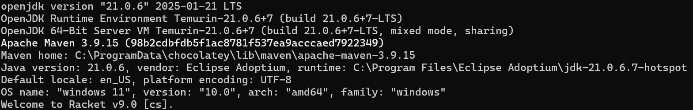
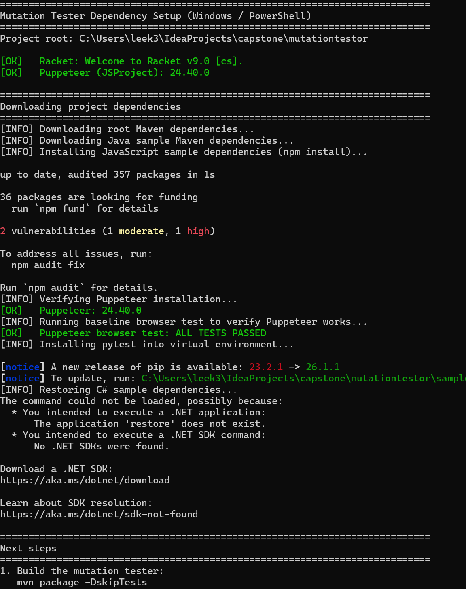
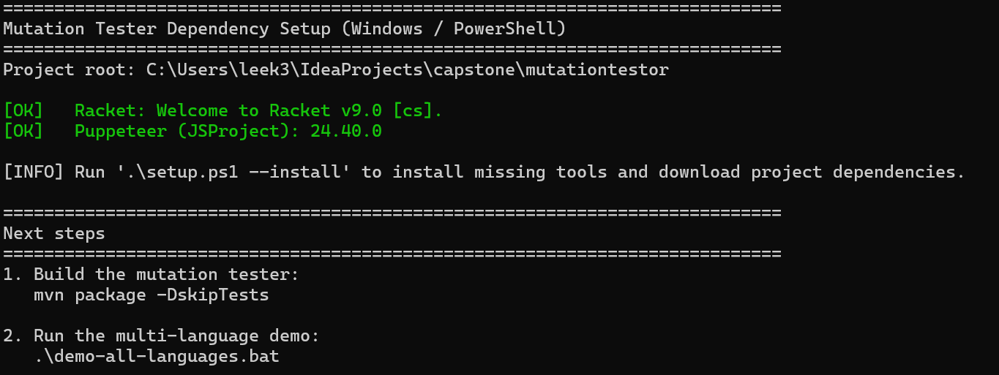

# MutationTester - Setup & Usage Guide

---

## Table of Contents

1. [Prerequisites](#1-prerequisites)
2. [Clone the Repository](#2-clone-the-repository)
3. [Install Required Runtimes](#3-install-required-runtimes)
4. [Verify Dependencies](#4-verify-dependencies)
5. [Build the Project](#5-build-the-project)
6. [Configure a Mutation Run](#6-configure-a-mutation-run)
7. [Run Mutation Testing](#7-run-mutation-testing)
8. [View the HTML Report](#8-view-the-html-report)
9. [Run the Full Multi-Language Demo](#9-run-the-full-multi-language-demo)
10. [Troubleshooting](#10-troubleshooting)

---

## 1. Prerequisites

Before setting up the project, ensure the following tools are installed on your machine.

| Tool | Required Version | Purpose |
|---|---|---|
| Java / JDK | 17+ | Compiles and runs the tool |
| Maven | 3.8+ | Build system |
| Git | Any | Clone the repository |
| Racket | 8.x | Racket language support |
| Python 3 | 3.8+ | Python language support |
| Node.js / npm | 18+ | JavaScript language support |
| .NET SDK | net10.0 | C# language support |

> `java -version; mvn -version; racket --version`
> 

---

## 2. Clone the Repository

Open a terminal and clone the repository.

```bash
git clone https://github.com/<your-org>/MutationTester.git
cd MutationTester
```

Switch to the development branch if applicable:

```bash
git checkout ast-integration
```

---

## 3. Install Required Runtimes

### Windows

Run the PowerShell setup script from the project root (elevated prompt recommended for `--install`):

```powershell
# Check only
.\setup.ps1

# Install missing tools + download project dependencies
.\setup.ps1 -Install
```

Or use the batch launcher:

```bat
setup-dependencies.bat --install
```

### macOS / Linux

```bash
# Check only
bash setup-dependencies.sh

# Install missing tools + download project dependencies
bash setup-dependencies.sh --install
```

The script automatically detects your package manager (`brew`, `apt`, or `choco`) and installs any missing tools.

> `setup.ps1 -Install` showing `[OK]` lines for Java, Maven, .NET, Python, npm, and Racket.
> 

---

## 4. Verify Dependencies

After installation, re-run the check-only mode to confirm everything is green:

Expected output (all lines should read `[OK]`):

```
[OK]   Java/JDK 17+: openjdk 17.x.x ...
[OK]   Maven: Apache Maven 3.x.x ...
[OK]   .NET SDK (net10.0): 10.x.x
[OK]   Python 3: Python 3.x.x
[OK]   Node.js/npm: x.x.x
[OK]   Racket: Racket v8.x ...
[OK]   Puppeteer (JSProject): x.x.x
```

> 

---

## 5. Build the Project

From the project root, compile and package the JAR:

```bash
mvn package -DskipTests
```

To also run unit tests during the build:

```bash
mvn clean package
```

A successful build produces the JAR at:

```
target/MutationTester-1.0-SNAPSHOT-jar-with-dependencies.jar
```

> 📸 **Screenshot:** Terminal showing `mvn package` completing with `BUILD SUCCESS` and the path to the generated JAR file.

---

## 6. Configure a Mutation Run

The tool reads a `.config` file that specifies the target project and mutation settings. A config file uses simple `key=value` syntax.

There are three families of config files included in the repo:

- **`new___.config`** - targets the bundled sample projects under `samples/`; easiest starting point
- **`real___.config`** - targets real open-source projects (external repos you must clone separately)
- **`config-context.txt`** - uses context-sensitive MSL spec files for more precise, scope-aware mutations

### Config File Fields

| Key | Required | Description |
|---|-------|---|
| `source_code_directory` | Required | Path to source files relative to the project directory |
| `mutator_type` | Required | Mutation operator(s) to apply (e.g. `AOR_PLUS_TO_MINUS`, `ALL`, or comma-separated list) |
| `test_command` | Required | Command to run the test suite |
| `compile_command` | Optional | Command to compile before testing (leave blank if not needed) |
| `test_mode` | Optional | `AUTO` (default), `AST`, `DICTIONARY`, or `MSL` |
| `custom_mutation_spec` | Optional | Path to a `.txt` or `.spec` MSL spec file |
| `coverage_command` | Optional | Command to generate a coverage report |
| `coverage_report` | Optional | Path to the generated coverage file |

### Using MutationTester on a Local Project

To test a local project, create a config file for that project and pass both the project directory and config file to the MutationTester JAR.

General config format:

```text
source_code_directory=<path-to-source-code>
mutator_type=CUSTOM
custom_mutation_spec=<path-to-msl-spec-file>
compile_command=<command-to-build-project>
test_command=<command-to-run-tests>
```

Important notes:

- `source_code_directory` is relative to the target project root.
- `compile_command` is optional. Leave it blank if the project does not need a compile step.
- `test_command` must run the target project's tests.
- The original tests must pass before mutation testing can continue.
- `custom_mutation_spec` points to the MSL spec file used for custom mutations.

#### Java Project

Example config:

```text
source_code_directory=src/main/java
mutator_type=CUSTOM
custom_mutation_spec=OperatorMutations.txt
compile_command=mvn test-compile
test_command=mvn test
```

Run command:

```bash
java -jar target/MutationTester-1.0-SNAPSHOT-jar-with-dependencies.jar /path/to/java/project my-java.config
```

#### JavaScript Project

Example config:

```text
source_code_directory=src
mutator_type=CUSTOM
custom_mutation_spec=OperatorMutations.txt
compile_command=
test_command=npm test
```

For context-sensitive JavaScript mutations:

```text
source_code_directory=src
mutator_type=CUSTOM
custom_mutation_spec=specs/context-sensitive-mutations.spec
compile_command=echo "No compilation needed"
test_command=cd browser-tests && node run-with-puppeteer.js
```

If the project uses Mocha and `node_modules/.bin` does not work after copying into the temporary workdir, call Mocha directly:

```text
source_code_directory=lib
mutator_type=CUSTOM
custom_mutation_spec=OperatorMutations.txt
compile_command=
test_command=node node_modules/mocha/bin/mocha.js test/
```

Run command:

```bash
java -jar target/MutationTester-1.0-SNAPSHOT-jar-with-dependencies.jar /path/to/javascript/project my-js.config
```

Bundled context-sensitive demo:

```bash
java -jar target/MutationTester-1.0-SNAPSHOT-jar-with-dependencies.jar samples/JSProject samples/JSProject/config-context.txt
```

#### Python Project

Example config:

```text
source_code_directory=src
mutator_type=CUSTOM
custom_mutation_spec=OperatorMutations.txt
compile_command=
test_command=python3 -m pytest tests
```

For context-sensitive Python mutations:

```text
source_code_directory=src
mutator_type=CUSTOM
custom_mutation_spec=specs/context-sensitive-python.spec
compile_command=
test_command=python3 -m pytest tests
```

Run command:

```bash
java -jar target/MutationTester-1.0-SNAPSHOT-jar-with-dependencies.jar /path/to/python/project my-python.config
```

#### C# Project

Example config:

```text
source_code_directory=src/MyProject
mutator_type=CUSTOM
custom_mutation_spec=OperatorMutations.txt
compile_command=dotnet build tests/MyProject.Tests/MyProject.Tests.csproj
test_command=dotnet test tests/MyProject.Tests/MyProject.Tests.csproj
```

For context-sensitive C# mutations:

```text
source_code_directory=src/MyProject
mutator_type=CUSTOM
custom_mutation_spec=specs/context-sensitive-mutations.spec
compile_command=dotnet build tests/MyProject.Tests/MyProject.Tests.csproj
test_command=dotnet test tests/MyProject.Tests/MyProject.Tests.csproj
```

Run command:

```bash
java -jar target/MutationTester-1.0-SNAPSHOT-jar-with-dependencies.jar /path/to/csharp/project my-csharp.config
```

#### Racket Project

Example config:

```text
source_code_directory=src
mutator_type=CUSTOM
custom_mutation_spec=OperatorMutations.txt
compile_command=
test_command=raco test tests
```

For context-sensitive Racket mutations:

```text
source_code_directory=project/src
mutator_type=CUSTOM
custom_mutation_spec=specs/context-sensitive-racket.spec
compile_command=
test_command=racket ./project/tests/racket-project.rkt
```

Run command:

```bash
java -jar target/MutationTester-1.0-SNAPSHOT-jar-with-dependencies.jar /path/to/racket/project my-racket.config
```

Bundled context-sensitive demo:

```bash
java -jar target/MutationTester-1.0-SNAPSHOT-jar-with-dependencies.jar samples/RacketProject samples/RacketProject/config-context.txt
```


## 7. Run Mutation Testing

Invoke the tool with the project directory and config file as arguments:

```bash
java -jar target/MutationTester-1.0-SNAPSHOT-jar-with-dependencies.jar <project_directory> <config_file>
```

The MutationTester will:

1. Copy the target project into a temporary working directory.
2. Run the baseline tests.
3. Stop if the original tests fail.
4. Scan the source files for mutation points.
5. Apply one mutation at a time.
6. Run the configured test command for each mutant.
7. Generate a mutation testing report.


## 8. View the HTML Report

After the run completes, open the report in a browser:

```bash
# macOS
open output/report/mutation-report-demo.html

# Linux
xdg-open output/report/mutation-report-demo.html

# Windows
start output/report/mutation-report-demo.html
```

The report includes:

- **Mutation score** (percentage of mutants killed)
- **Per-file breakdown** with mutation counts
- **Source code overlay** highlighting mutated lines (PIT-style)
- **Survivor list** - click a surviving mutant to jump to the corresponding line
- **Equivalent mutant marking** - surviving mutants can be flagged via the UI (requires the API server on `localhost:8081`)

> 📸 **Screenshot:** The HTML report open in a browser showing the overall mutation score percentage at the top, the per-file table, and at least one highlighted source line with a mutation annotation.

> 📸 **Screenshot (second):** The survivor detail panel - click on one surviving mutant entry to show the before/after diff and the source line jump.

---

## 9. Run the Full Multi-Language Demo

To run all five languages in sequence and collect reports:

### macOS / Linux

```bash
bash demo-all-languages.sh
```

### Windows

```bat
demo-all-languages.bat
```

Reports for each language are saved to:

```
demo-output/
  java/           mutation-report-demo.html
  javascript/     mutation-report-demo.html
  csharp/         mutation-report-demo.html
  python/         mutation-report-demo.html
  racket/         mutation-report-demo.html
```

Expected summary at the end of the run:

```
DEMO COMPLETE
  Projects passed: 5 / 5
```

> 📸 **Screenshot:** Terminal showing the demo script's final summary block: `DEMO COMPLETE` with `Projects passed: 5 / 5` and the list of output paths.

---
