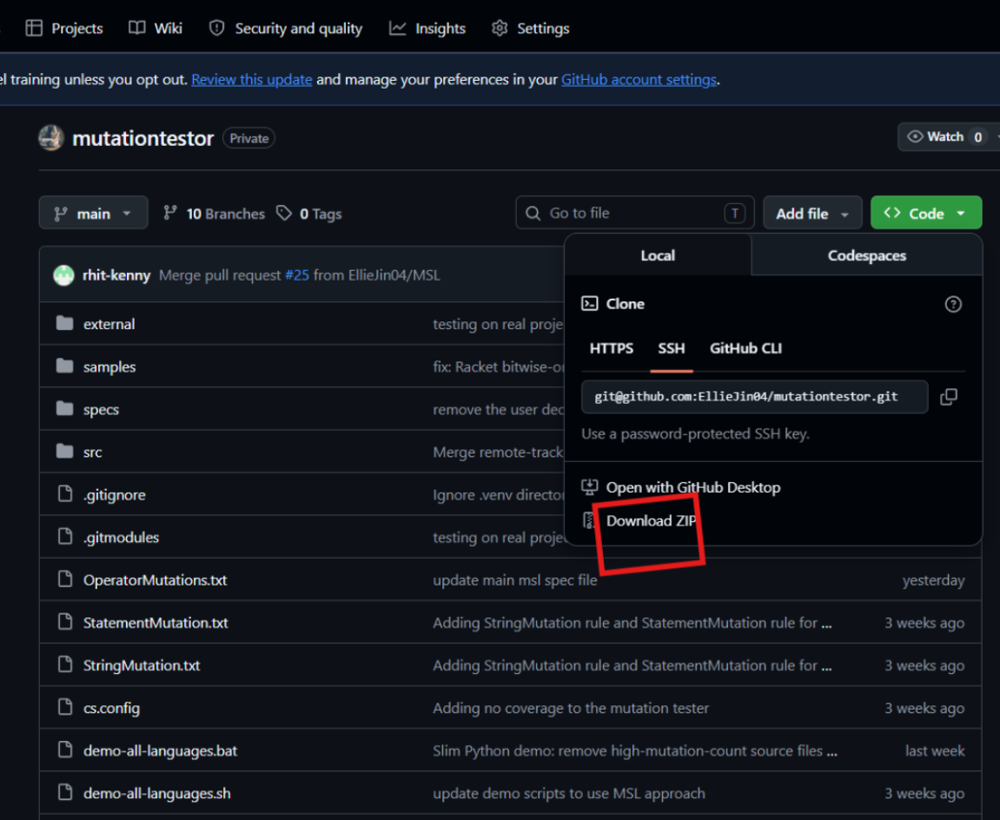
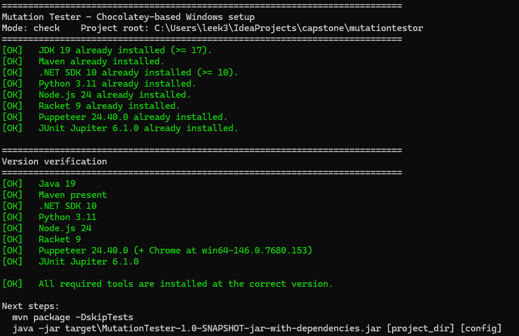
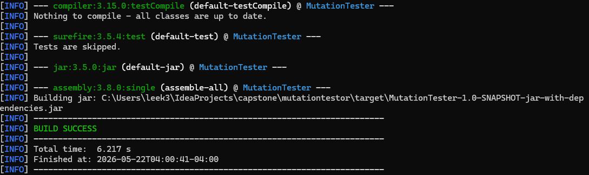
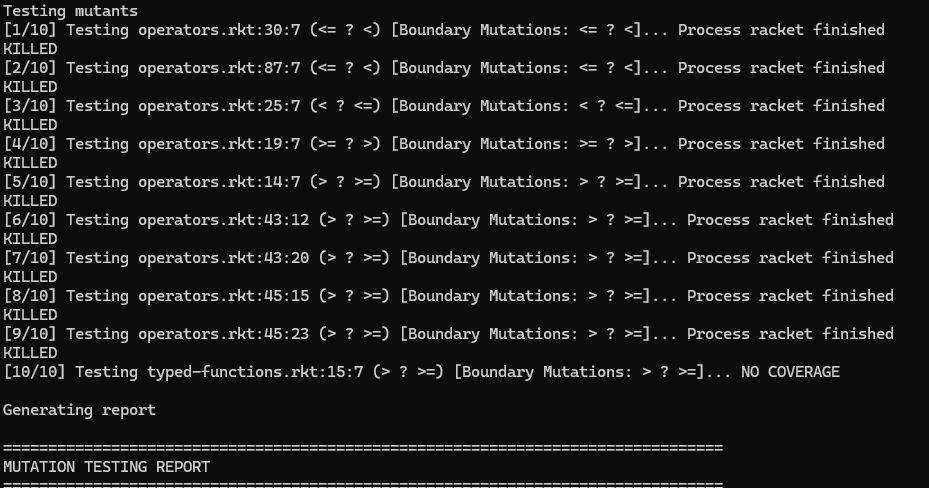
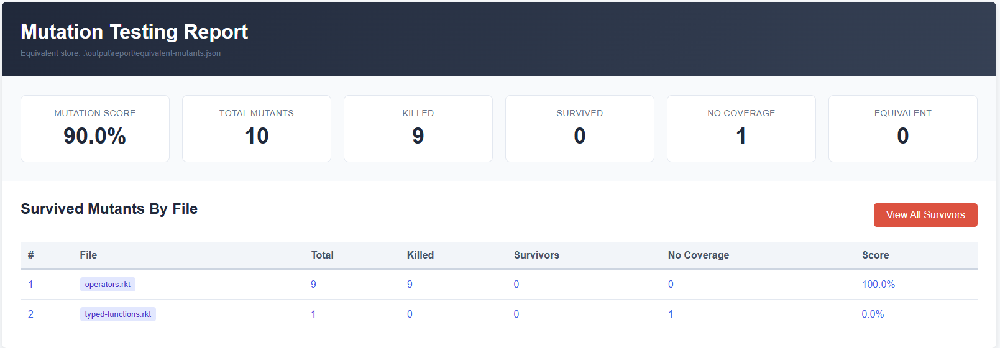
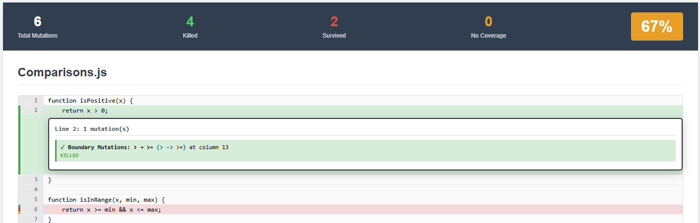

# MutationTester - Setup Guide

## Prerequisites

| Tool | Required Version | Purpose |
|------|-----------------|---------|
| Java / JDK | 17+ | Compiles and runs the tool |
| Maven | 3.8+ | Build system |
| Git | Any | Clone the repository |
| Racket | 8.x | Racket language support |
| Python 3 | 3.8+ | Python language support |
| Node.js / npm | 18+ | JavaScript support (Puppeteer) |
| .NET SDK | **10.0** | C# language support |

---

## 1. Clone the Repository

**Option A - Git clone:**

```bash
git clone https://github.com/EllieJin04/mutationtestor.git
cd mutationtestor
```

**Option B - Manual download (no Git required):**

1. Open <https://github.com/EllieJin04/mutationtestor> in your browser
2. Click the green **Code** button -> **Download ZIP**
3. Extract the ZIP to a folder of your choice (e.g. `C:\Multi-Language_mutationtestor`)
4. Open Windows Terminal and navigate to that folder



---

## 2. Install Dependencies

From the project root, run the setup script in an **elevated (Administrator) PowerShell**:

```powershell
.\chocolatey-setup.ps1 --install
```

This installs Chocolatey (if needed) and then installs all required tools: Java 21, Maven, Git, Racket, Python 3, Node.js, and .NET SDK 10. **.NET 10 is required** - earlier versions will cause a build failure.

> **If PowerShell blocks the script**, run it as a one-time bypass:
>
> ```powershell
> powershell -ExecutionPolicy Bypass -File .\chocolatey-setup.ps1
> ```

---

## 3. Verify Dependencies

When the script finishes, it prints a verification summary. All lines should read `[OK]` before proceeding. To re-run verification at any time:

```powershell
.\chocolatey-setup.ps1
```

Expected output:

```
[OK] Java/JDK 17+:          openjdk 21.x.x ...
[OK] Maven:                 Apache Maven 3.x.x ...
[OK] .NET SDK (net10.0):    10.x.x
[OK] Python 3:              Python 3.x.x
[OK] Node.js/npm:           x.x.x
[OK] Racket:                Racket v8.x ...
[OK] Puppeteer (JSProject): x.x.x
```



---

## 4. Build the Project

From the project root, compile and package the JAR:

```bash
# Skip tests (faster)
mvn package -DskipTests

# Include unit tests
mvn clean package
```

A successful build produces:

```
target/MutationTester-1.0-SNAPSHOT-jar-with-dependencies.jar
```



---

## 5. Run Mutation Testing

Invoke the tool with the target project directory and a config file:

```bash
java -jar target/MutationTester-1.0-SNAPSHOT-jar-with-dependencies.jar <project_directory> <config_file>
```

The tool copies the project into a temporary working directory, runs the baseline tests (and stops if they fail), then applies each mutation one at a time, re-runs the tests, and generates a report.

### Config Files

A config file is a plain `.config` or `.txt` file using `key=value` syntax. It tells MutationTester where your source lives, how to build it, how to run tests, and which mutations to apply.

The repo includes ready-to-use configs under `samples/` - these are the easiest starting point. For your own project, create a new file alongside it:

```text
source_code_directory=src/main/java
mutator_type=CUSTOM
custom_mutation_spec=OperatorMutations.txt
compile_command=mvn test-compile
test_command=mvn test
```

**Field reference:**

- `source_code_directory` - path to source files, relative to the project root
- `mutator_type` - `ALL`, a specific operator like `AOR_PLUS_TO_MINUS`, or `CUSTOM` (to use a spec file)
- `custom_mutation_spec` - path to a `.txt` or `.spec` MSL spec file defining custom mutation rules; only used when `mutator_type=CUSTOM`
- `compile_command` - command to build the project before testing; leave blank if no compile step is needed
- `test_command` - command to run the test suite (must pass on the original code before mutation begins)
- `test_mode` - `AUTO` (default), `AST`, `DICTIONARY`, or `MSL`
- `coverage_command` / `coverage_report` - optional; used to attach a coverage report to the output

**Language-specific examples:**

Java:
```text
source_code_directory=src/main/java
mutator_type=CUSTOM
custom_mutation_spec=OperatorMutations.txt
compile_command=mvn test-compile
test_command=mvn test
```

Python:
```text
source_code_directory=src
mutator_type=CUSTOM
custom_mutation_spec=OperatorMutations.txt
compile_command=
test_command=python3 -m pytest tests
```

JavaScript:
```text
source_code_directory=src
mutator_type=CUSTOM
custom_mutation_spec=OperatorMutations.txt
compile_command=
test_command=npm test
```

C#:
```text
source_code_directory=src/MyProject
mutator_type=CUSTOM
custom_mutation_spec=OperatorMutations.txt
compile_command=dotnet build tests/MyProject.Tests/MyProject.Tests.csproj
test_command=dotnet test tests/MyProject.Tests/MyProject.Tests.csproj
```

Racket:
```text
source_code_directory=src
mutator_type=CUSTOM
custom_mutation_spec=OperatorMutations.txt
compile_command=
test_command=raco test tests/
```



---

## 6. View the HTML Report

After the run completes, open the report in a browser:

```powershell
# Windows
start output/report/mutation-report-demo.html
```

```bash
# macOS
open output/report/mutation-report-demo.html

# Linux
xdg-open output/report/mutation-report-demo.html
```

You can also open the report directly in your IDE. In IntelliJ IDEA, right-click the file in the Project panel and select **Open In > Browser**. In VS Code, open the file and use the **Live Preview** or **Open with Live Server** extension, or right-click and choose **Open in Default Browser** if you have that option installed. Either way, the report is a standalone HTML file and requires no web server to view.

The report includes:

- **Mutation score** - percentage of mutants killed
- **Per-file breakdown** with mutation counts
- **Source code overlay** highlighting mutated lines (PIT-style)
- **Survivor list** - click a surviving mutant to jump to the corresponding line
- **Equivalent mutant marking** - surviving mutants can be flagged via the UI

> Equivalent mutant marking requires the API server running on `localhost:8081`.



