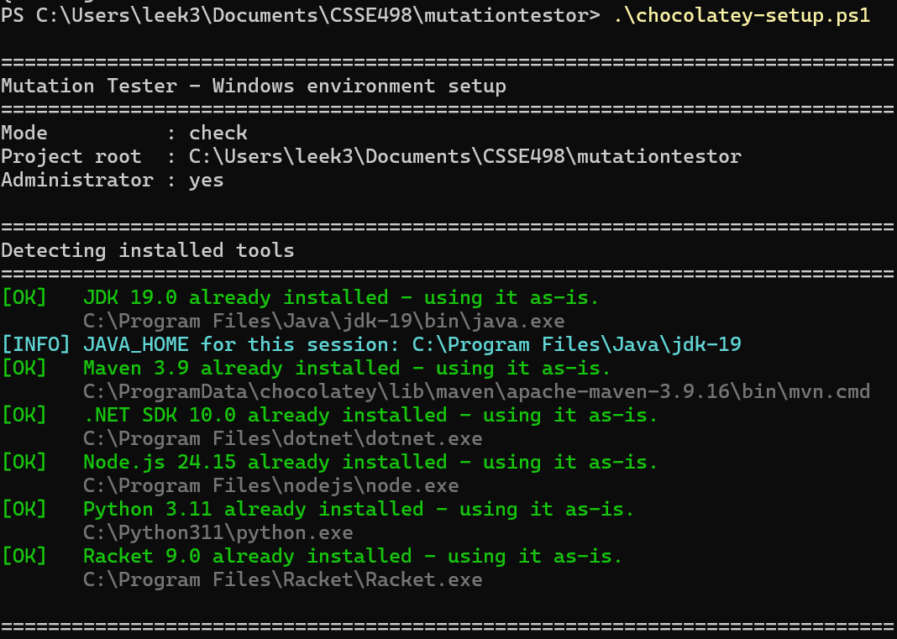
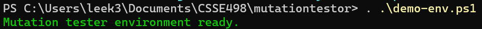

# MutationTester - Setup Guide

## Prerequisites

| Tool | Required Version | Purpose |
|------|-----------------|---------|
| Java / JDK | 17+ | Compiles and runs the tool |
| Maven | 3.8+ | Build system |
| Git | Any | Clone the repository |
| Racket | 8.x | Racket language support |
| Python 3 | 3.8+ | Python language support |
| Node.js / npm | 18+ | JavaScript support (Puppeteer) |
| .NET SDK | **10.0** | C# language support |

---

## 1. Clone the Repository

**Option A - Git clone:**

```bash
git clone https://github.com/lesereli000/mutationtestor.git
cd mutationtestor
```

**Option B - Manual download (no Git required):**

1. Open <https://github.com/lesereli000/mutationtestor> in your browser
2. Click the green **Code** button -> **Download ZIP**
3. Extract the ZIP to a folder of your choice (e.g. `C:\Multi-Language_mutationtestor`)
4. Open Windows Terminal and navigate to that folder


---

## 2. Install Dependencies

First, see what is already on the machine. This changes nothing:

```powershell
.\chocolatey-setup.ps1
```

Then install whatever came back missing:

```powershell
.\chocolatey-setup.ps1 --install
```

Useful variations:

| Command | Effect |
|---------|--------|
| `--install --minimal` | Skips the slow optional pieces (Racket, the ~170 MB Puppeteer Chrome download) |
| `--install --portable` | Never calls Chocolatey; unpacks tools into `.tools\` instead. Use when you have no Administrator rights |
| `--install --only dotnet,node` | Only touches the listed tools |
| `--install --skip racket` | Leaves the listed tools alone |

What the script will and will not do:

- **It never upgrades or replaces anything you already have.** If a usable JDK, Maven, .NET SDK, Node, Python, or Racket is already installed, it is detected and used as-is. A pre-existing .NET 8 or 9 is fine — .NET SDKs install side by side, so adding 10 does not disturb them.
- **It never edits your system PATH.** Instead it writes `demo-env.ps1` and `demo-env.cmd`, which put the detected tools on PATH for one shell session only.
- **Administrator rights are optional.** Without them it skips Chocolatey and downloads the official upstream archives into `.tools\`.
- **To undo everything:** delete `.tools\`, `demo-env.ps1`, and `demo-env.cmd`.

> **If PowerShell blocks the script**, run it as a one-time bypass:
>
> ```powershell
> powershell -ExecutionPolicy Bypass -File .\chocolatey-setup.ps1 --install
> ```

---

## 3. Verify Dependencies

The script ends with a summary table. Re-run it at any time — it is safe and read-only without `--install`:

```powershell
.\chocolatey-setup.ps1
```

Expected output:


```
Tool     Status Version Required Location
----     ------ ------- -------- --------
JDK      OK     17.0    yes      C:\Program Files\Eclipse Adoptium\jdk-17...\bin\java.exe
Maven    OK     3.9     yes      C:\ProgramData\chocolatey\lib\maven\...\bin\mvn.cmd
.NET SDK OK     10.0    no       C:\Program Files\dotnet\dotnet.exe
Node.js  OK     22.11   no       C:\Program Files\nodejs\node.exe
Python   OK     3.11    no       C:\Python311\python.exe
Racket   OK     8.12    no       C:\Program Files\Racket\Racket.exe
```

Only **JDK** and **Maven** are required — they run the tester itself. Each of the others gates one language sample, so if `.NET SDK` is missing you lose the C# demo and nothing else.

Before building or running, load the toolchain into your shell:

```powershell
. .\demo-env.ps1
```

```cmd
:: cmd.exe
demo-env.cmd
```



---

## 2b. Alternative: run it in Docker

If you want one environment that behaves identically everywhere — and no installs at all on the presenting machine — build the image once, ahead of time. Works the same on Windows, macOS and Linux:

```bash
docker build -t mutationtester:demo .
docker run --rm -it mutationtester:demo
```

The image is not published anywhere, so you must build it yourself. Running `docker run` without building first fails with `pull access denied` — that only means Docker looked on Docker Hub and found nothing.

That drops you at a shell inside the container. From there, run any of the bundled samples:

```bash
java -jar target/MutationTester-1.0-SNAPSHOT-jar-with-dependencies.jar samples/PytestProject samples/PytestProject/config-context.txt
java -jar target/MutationTester-1.0-SNAPSHOT-jar-with-dependencies.jar samples/JSProject samples/JSProject/config-context.txt
java -jar target/MutationTester-1.0-SNAPSHOT-jar-with-dependencies.jar samples/CSProject samples/CSProject/config-context.txt
java -jar target/MutationTester-1.0-SNAPSHOT-jar-with-dependencies.jar samples/RacketProject samples/RacketProject/config-context.txt
```

The image bakes in JDK 17, Maven, .NET 10, Node, Python + pytest, Racket, and Chrome for Puppeteer, and pre-builds the JAR and every package cache, so the demo needs no network.

### Running it against your own project

A container has its own filesystem. Nothing from your computer is visible inside it unless you say so, which is what *mounting* means — `-v` maps a folder on your machine to a path inside the container:

```
-v  C:\folder\on\your\machine  :  /path/inside/the/container
```

So `-v "${PWD}/myproject:/work"` makes your `myproject` folder appear as `/work` inside the container. Every path you pass to the tool after that (`/work/mutation.config`) is a path **inside** the container, not on your machine.

Your project needs a config file in it. A complete, working example:

```text
myproject/
  src/calc.py
  tests/test_calc.py
  mutation.config
```

```text
source_code_directory=src/main/java/mutationtester/model
mutator_type=CUSTOM
custom_mutation_spec=OperatorMutations.txt
compile_command=mvn -q -DskipTests compile
test_command=mvn test
```

Then run it. Note the line-continuation character differs by shell — `\` on macOS/Linux, a backtick on PowerShell. Getting it wrong leaves the shell sitting at a `>` prompt waiting for you to finish the command; press Ctrl+C and try again.

macOS / Linux:

```bash
docker run --rm -w /work -v "$PWD/myproject:/work" mutationtester:demo \
  java -jar /opt/mutationtester/target/MutationTester-1.0-SNAPSHOT-jar-with-dependencies.jar /work /work/mutation.config
```

Windows PowerShell:

```powershell
docker run --rm -w /work -v "${PWD}/myproject:/work" mutationtester:demo `
  java -jar /opt/mutationtester/target/MutationTester-1.0-SNAPSHOT-jar-with-dependencies.jar /work /work/mutation.config
```

**`-w /work` is not optional.** It makes the container write its output into the mounted folder, so the HTML report ends up at `myproject/output/report/mutation-report-demo.html` on your machine. Without it the report is written inside the container and `--rm` deletes it the moment the run finishes — the tool still prints "HTML report generated at...", but the file is gone. The jar path must be absolute for the same reason, since `/work` is now the working directory.

To move the image to a machine with no registry access:

```bash
docker save mutationtester:demo | gzip > mutationtester-demo.tar.gz
docker load < mutationtester-demo.tar.gz
```

> On an Apple Silicon Mac, build the image on that Mac rather than loading a tarball built on Windows — the transferred image would be x86 and run under emulation.

> Build this image and run it end-to-end **before** you rely on it for a demo. It requires Docker Desktop, which on Windows needs Administrator rights, WSL2, and hardware virtualization.

---

## 4. Build the Project

From the project root, compile and package the JAR:

```bash
# Skip tests (faster)
mvn package -DskipTests

# Include unit tests
mvn clean package
```

A successful build produces:

```
target/MutationTester-1.0-SNAPSHOT-jar-with-dependencies.jar
```


---

## 5. Run Mutation Testing

Invoke the tool with the target project directory and a config file:

```bash
java -jar target/MutationTester-1.0-SNAPSHOT-jar-with-dependencies.jar <project_directory> <config_file>
```

The tool copies the project into a temporary working directory, runs the baseline tests (and stops if they fail), then applies each mutation one at a time, re-runs the tests, and generates a report.

### Run on Your Own Local Project

After cloning and building MutationTester, you can run it against any local project on your computer. The target project does **not** need to be inside the MutationTester repository.

1. Build MutationTester from the cloned repository:

```bash
cd mutationtestor
mvn package -DskipTests
```

2. Create a config file for your target project. You can place it inside the target project or anywhere else on your computer.

3. Run MutationTester with the target project path and config path:

```bash
java -jar target/MutationTester-1.0-SNAPSHOT-jar-with-dependencies.jar /path/to/your/project /path/to/your/project/mutation.config
```

Windows example:

```powershell
java -jar target\MutationTester-1.0-SNAPSHOT-jar-with-dependencies.jar C:\Users\you\Projects\MyProject C:\Users\you\Projects\MyProject\mutation.config
```

macOS/Linux example:

```bash
java -jar target/MutationTester-1.0-SNAPSHOT-jar-with-dependencies.jar ~/Projects/MyProject ~/Projects/MyProject/mutation.config
```

The `source_code_directory`, `compile_command`, and `test_command` values inside the config file are relative to the target project directory, not the MutationTester repository.

Example target project layout:

```text
MyProject/
  src/
  tests/
  mutation.config
```

Example command from the MutationTester repository:

```bash
java -jar target/MutationTester-1.0-SNAPSHOT-jar-with-dependencies.jar ../MyProject ../MyProject/mutation.config
```

### Config Files

A config file is a plain `.config` or `.txt` file using `key=value` syntax. It tells MutationTester where your source lives, how to build it, how to run tests, and which mutations to apply.

The repo includes ready-to-use configs under `samples/` - these are the easiest starting point. For your own project, create a new file alongside it:

```text
source_code_directory=src/main/java
mutator_type=CUSTOM
custom_mutation_spec=OperatorMutations.txt
compile_command=mvn test-compile
test_command=mvn test
```

**Field reference:**

- `source_code_directory` - path to source files, relative to the project root
- `mutator_type` - `ALL`, a specific operator like `AOR_PLUS_TO_MINUS`, or `CUSTOM` (to use a spec file)
- `custom_mutation_spec` - path to a `.txt` or `.spec` MSL spec file defining custom mutation rules; only used when `mutator_type=CUSTOM`. If no file exists at that path, the copy of the same name bundled in the jar is used (`OperatorMutations.txt`, `StatementMutation.txt`, `StringMutation.txt`)
- `compile_command` - command to build the project before testing; leave blank if no compile step is needed
- `test_command` - command to run the test suite (must pass on the original code before mutation begins)
- `coverage_command` / `coverage_report` - optional; used to attach a coverage report to the output
- `min_mutation_score` - optional, 0-100. The tool exits with code 2 when the score is below it (code 1 means it could not run, 0 means it passed), so CI can fail on it. See [Running MutationTester in GitHub Actions](../docs/ci/README.md)
- `exclude_source` - optional, comma-separated folders or files (relative to the project root, like `source_code_directory`) that are never mutated, e.g. `exclude_source=src/main/java/main/ui`. Excluded code produces no mutants and doesn't count in the score
- `time_limit_minutes` - optional, above 0. After this long (from when the tool starts) no new mutants are tested; the report covers the tested ones and is marked partial, and the tool exits with code 3

**Language-specific examples:**

Java:

```text
source_code_directory=src/main/java
mutator_type=CUSTOM
custom_mutation_spec=OperatorMutations.txt
compile_command=mvn test-compile
test_command=mvn test
```

Python:

```text
source_code_directory=src
mutator_type=CUSTOM
custom_mutation_spec=OperatorMutations.txt
compile_command=
test_command=python3 -m pytest tests
```

JavaScript:

```text
source_code_directory=src
mutator_type=CUSTOM
custom_mutation_spec=OperatorMutations.txt
compile_command=
test_command=npm test
```

C#:

```text
source_code_directory=src/MyProject
mutator_type=CUSTOM
custom_mutation_spec=OperatorMutations.txt
compile_command=dotnet build tests/MyProject.Tests/MyProject.Tests.csproj
test_command=dotnet test tests/MyProject.Tests/MyProject.Tests.csproj
```

Racket:

```text
source_code_directory=src
mutator_type=CUSTOM
custom_mutation_spec=OperatorMutations.txt
compile_command=
test_command=raco test tests/
```

Local project command examples:

```bash
# Java Maven project
java -jar target/MutationTester-1.0-SNAPSHOT-jar-with-dependencies.jar /path/to/java-project /path/to/java-project/mutation.config

# Python pytest project
java -jar target/MutationTester-1.0-SNAPSHOT-jar-with-dependencies.jar /path/to/python-project /path/to/python-project/mutation.config

# JavaScript npm project
java -jar target/MutationTester-1.0-SNAPSHOT-jar-with-dependencies.jar /path/to/js-project /path/to/js-project/mutation.config

# C# dotnet project
java -jar target/MutationTester-1.0-SNAPSHOT-jar-with-dependencies.jar /path/to/csharp-project /path/to/csharp-project/mutation.config

# Racket project
java -jar target/MutationTester-1.0-SNAPSHOT-jar-with-dependencies.jar /path/to/racket-project /path/to/racket-project/mutation.config
```

For context-sensitive mutations, JavaScript, Python, C#, and Racket all use the shared spec file:

```text
custom_mutation_spec=specs/context-sensitive-mutations.spec
```

Bundled context-sensitive demos:

```bash
java -jar target/MutationTester-1.0-SNAPSHOT-jar-with-dependencies.jar samples/JSProject samples/JSProject/config-context.txt
java -jar target/MutationTester-1.0-SNAPSHOT-jar-with-dependencies.jar samples/PytestProject samples/PytestProject/config-context.txt
java -jar target/MutationTester-1.0-SNAPSHOT-jar-with-dependencies.jar samples/CSProject samples/CSProject/config-context.txt
java -jar target/MutationTester-1.0-SNAPSHOT-jar-with-dependencies.jar samples/RacketProject samples/RacketProject/config-context.txt
```

If a JavaScript project uses Mocha and `node_modules/.bin` does not work after copying into the temporary workdir, call Mocha directly:

```text
source_code_directory=lib
mutator_type=CUSTOM
custom_mutation_spec=OperatorMutations.txt
compile_command=
test_command=node node_modules/mocha/bin/mocha.js test/
```


---

## 6. View the HTML Report

After the run completes, open the report in a browser:

```powershell
# Windows
start output/report/mutation-report-demo.html
```

```bash
# macOS
open output/report/mutation-report-demo.html

# Linux
xdg-open output/report/mutation-report-demo.html
```

You can also open the report directly in your IDE. In IntelliJ IDEA, right-click the file in the Project panel and select **Open In > Browser**. In VS Code, open the file and use the **Live Preview** or **Open with Live Server** extension, or right-click and choose **Open in Default Browser** if you have that option installed. Either way, the report is a standalone HTML file and requires no web server to view.

The report includes:

- **Mutation score** - percentage of mutants killed
- **Per-file breakdown** with mutation counts
- **Source code overlay** highlighting mutated lines (PIT-style)
- **Survivor list** - click a surviving mutant to jump to the corresponding line
- **Equivalent mutant marking** - surviving mutants can be flagged via the UI

> Marking works without a server. With the API server running on `localhost:8081`, marks are saved immediately; without it, the page offers a download of the updated list. Reports from GitHub Actions save marks to the project's `mutation-data` branch instead (see [Running MutationTester in GitHub Actions](../docs/ci/README.md)).


